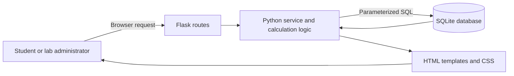
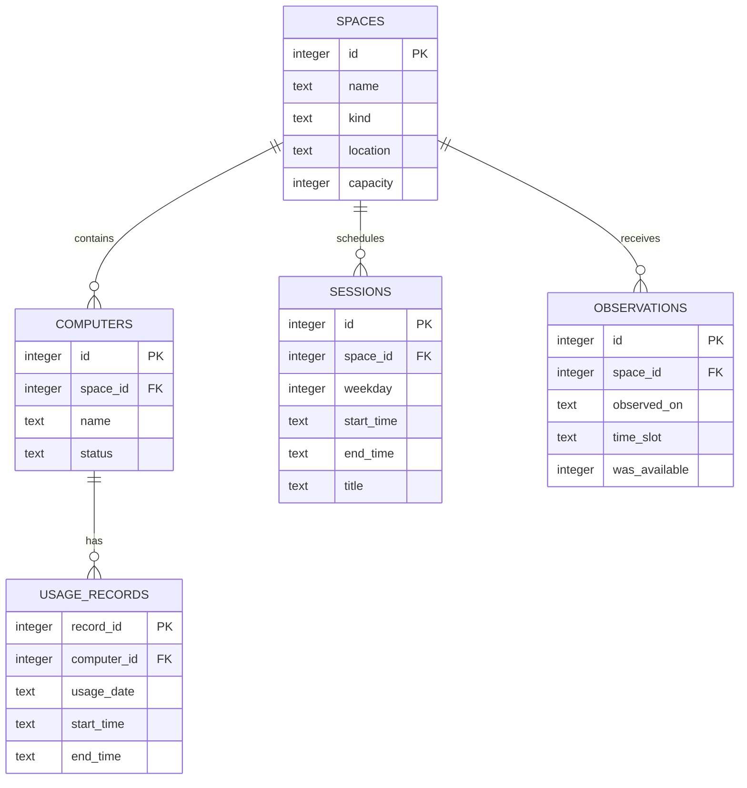

# Smart Laboratory Computer Usage and Campus Space Availability Predictor

## Abstract

Spacewise is a local web application that helps students check classroom timetable availability and the current status of computers in campus laboratories. It combines timetable records, manually maintained computer status, usage history, and historical availability observations. Set theory is used to classify computers, empirical discrete probability estimates availability for a selected weekday and time, and database relations connect spaces to computers, timetable sessions, observations, and usage records. The application uses Python, Flask, SQLite, pandas, NumPy, and SimPy; it does not train a machine-learning model. All included records are synthetic demonstration data.

## 1. Introduction

Students may need to check whether a classroom is scheduled or whether a lab has computers marked available before travelling to it. Spacewise presents these records in one dashboard. The system separates current status and timetable restrictions from historical probability: historical availability is an estimate and does not guarantee future availability.

## 2. Problem statement

Campus space information may be spread across timetables and informal updates. Without a single view, students cannot quickly compare scheduled rooms, lab computer status, or past availability patterns. This project builds a small local prototype that organizes this information and demonstrates discrete mathematics through working features.

## 3. Objectives

1. Show classrooms and laboratories for a selected weekday and time.
2. Record and display lab computer statuses: available, occupied, and maintenance.
3. Manage weekly space sessions and prevent overlapping timetable entries.
4. Record computer usage and calculate its duration.
5. Calculate empirical availability probability from observations, including the number of observations.
6. Recommend a currently eligible space using the observed probability and current available-computer count.
7. Demonstrate set operations and relational database links in an understandable interface.

## 4. Existing and proposed system

**Existing approach:** a student may need to ask staff, inspect a timetable, or walk to a room to learn whether computers appear available. Historical patterns are not summarized consistently.

**Proposed approach:** Spacewise provides a local dashboard backed by SQLite. Staff or project users maintain computer statuses, add timetable sessions, and enter usage or availability observations. Students can compare spaces for a selected time. The app makes clear which results come from current records and which come from historical estimates.

## 5. Requirements

### Hardware

- A computer capable of running Python 3 and a web browser.
- No sensors or networked laboratory hardware are required for this prototype.

### Software

- Python 3
- Flask
- SQLite via Python's built-in `sqlite3` module
- pandas for grouping historical observations and simulation runs
- NumPy for reproducible random inter-arrival and usage-duration samples
- SimPy for modeling student requests and computer queues as a discrete-event system
- HTML and CSS templates rendered by Flask

## 6. System architecture

The browser submits filters or forms to Flask routes. Python validates the input and reads or writes SQLite rows using parameterized queries. The route passes results into an HTML template for display.

## 7. Database design and relations

Primary keys uniquely identify rows. Foreign keys ensure each computer, session, observation, and usage record is attached to a valid parent row. The app enables SQLite foreign-key enforcement and uses SQL `JOIN` operations to display related space and computer names.

## 8. Discrete mathematics used

### 8.1 Set theory

Let `C` be the set of all registered lab computers. Define:

- `A`: computers marked available
- `O`: computers marked occupied
- `M`: computers marked under maintenance

The status field is restricted to one of these three values, so the sets are pairwise disjoint and partition `C`:

`A ∩ O = A ∩ M = O ∩ M = ∅`

`C = A ∪ O ∪ M`

The Set explorer implements union, intersection, difference, complement, and cardinality using Python `set` operations. Computer database IDs are used as set elements so identical labels in different labs remain distinct.

### 8.2 Discrete probability

For space `s`, weekday `d`, and time slot `t`, let `N(s,d,t)` be the valid recorded observations for that combination, and let `Y(s,d,t)` be the observations marked available. The empirical conditional probability is:

`P(available | space=s, weekday=d, slot=t) = Y(s,d,t) / N(s,d,t)`

If `N=0`, the app displays “No data.” The dashboard also shows `N`, since a percentage based on few observations is less informative. The estimate describes the sample; it is not a guarantee.

### 8.3 Relations

The database relation `Computer(space_id, ...)` associates each computer with one space. `Session(space_id, ...)` and `Observation(space_id, ...)` associate schedules and observations with spaces. `UsageRecord(computer_id, ...)` associates usage with a computer. Foreign keys enforce these links, and `JOIN` retrieves names across related tables.

## 9. Application modules

- **Availability dashboard:** filters by weekday and time, checks sessions and current lab statuses, shows historical probability, and ranks currently eligible spaces.
- **Space management:** adds classrooms and labs; new lab computers are created with an available status.
- **Computer management:** changes a computer's current status.
- **Admin portal:** administrators set lab computers to available, occupied, or under maintenance; students cannot make these status changes. A real local admin password can be configured, while the `python app.py` presentation mode offers an explicitly labeled local demo-admin entry.
- **Timetable:** adds recurring weekly sessions and rejects overlaps for the same space and day.
- **Usage log:** records computer, date, and start/end time; calculates duration and prevents overlapping records for the same computer and date.
- **Set explorer:** performs status-set operations.
- **Observation form:** records whether a space was available at a date and time.
- **Lab simulator:** uses current reported lab capacity and user-entered assumptions to simulate student arrivals, computer use, and queue waits over repeated runs.

## 10. Library use and simulation assumptions

The dashboard loads historical observations into a pandas DataFrame and filters by weekday and time to calculate the empirical fraction of available observations. For simulation, NumPy's random number generator samples exponential gaps between student arrivals and exponential computer-use durations. Their average values are entered by the user; the exponential distribution is a modeling assumption, not a measurement guaranteed by the existing demo data. SimPy represents each currently free computer as one unit of a shared resource. Each simulated student requests a computer, waits if all resources are busy, uses it for the sampled duration, and releases it. The simulation repeats with reproducible random seeds; pandas summarizes the runs using average wait, average number of arrivals, queue rate, and a 95th percentile of per-run maximum waits.

This illustrates probability distributions, averages, resources, event sequencing, and repeated trials. It is a what-if model only: it neither changes real computer status nor reserves computers, and its outputs should not be presented as real campus predictions until assumptions are calibrated with observed arrival and session data.

## 11. Recommendation logic

The dashboard first excludes spaces with a timetable session at the selected slot. A lab also needs at least one computer currently marked available. Among the eligible spaces, the app ranks by historical empirical probability; if probabilities are tied or absent, it uses available lab computer count and space capacity as tie-breakers. The recommended option is still subject to manual data accuracy and is not a reservation.

## 12. Testing and results

On 19 November 2026, the project was checked with Python 3.14 and Flask's in-process client using a temporary, isolated SQLite database. The automated suite is in `tests/test_app.py` and can be run with `python -m unittest discover -s tests -v`.

All seven automated tests passed. They checked page rendering and seed counts; status updates; unique set membership when computer labels repeat across labs; timetable and usage overlap rejection with adjacent intervals accepted; lab creation with linked computers; and weekday-specific probability, including the no-observation case. A separate migration check confirmed that an existing database receives the new usage table and eight clearly synthetic sample usage records.

These are functional checks on an isolated database, not a guarantee about every deployment. Before submission, capture screenshots from the running local app for the dashboard, Set explorer, and one data-entry page. Keep synthetic data clearly identified as demonstration data.

## 13. Limitations

- Included records are synthetic and must not be presented as actual campus records.
- Computer status is entered manually; there are no sensors or automatic occupancy updates.
- Timetable records repeat weekly and require manual updates when the institution's schedule changes.
- Usage and observation records are manually entered.
- Probability quality depends on the number and accuracy of recorded observations.
- The application is a local classroom prototype and has no user accounts, role management, or booking system.

## 14. Future scope

- Import official timetable data after obtaining an approved data source.
- Add user login and administrator/student roles.
- Add optional reservations with conflict checks.
- Integrate sensors only if the institution provides approved hardware and data access.
- Collect more verified observations and compare probability estimates over time.

## 15. Conclusion

Spacewise demonstrates how Python and discrete mathematics can support a practical campus availability prototype. Set operations classify lab computers, empirical probability summarizes past availability for a selected day and time, and SQLite relations connect the project's entities. The app distinguishes current schedule/status records from historical estimates and identifies the limitations of manually maintained sample data.

## 16. Group contribution plan

Use this as a planning split, then replace it with the work each person actually performs and understands:

1. Space/computer database and management pages.
2. Set operations and status validation.
3. Timetable, usage records, and conflict handling.
4. Probability observations, dashboard interpretation, and report integration.

## 17. References

- Python Software Foundation. *Python 3 Documentation: Set Types*. https://docs.python.org/3/library/stdtypes.html#set-types-set-frozenset
- Pallets Projects. *Flask 3.1 Quickstart*. https://flask.palletsprojects.com/en/stable/quickstart/
- SQLite Consortium. *SQLite Foreign Key Support*. https://www.sqlite.org/foreignkeys.html
